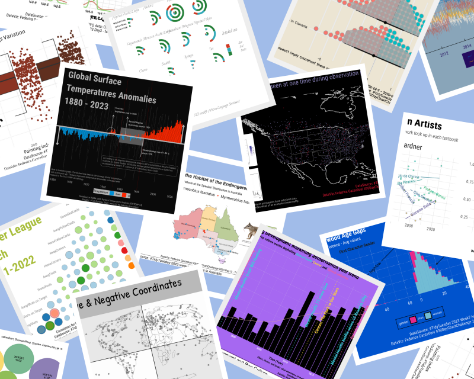

::: {.dataviz-page}

```{=html}
<section class="dataviz-hero" aria-labelledby="dataviz-portfolio-title">
  <div class="dataviz-hero__content">
    <p class="dataviz-eyebrow">My full portfolio · UPDVwR</p>
    <h2 id="dataviz-portfolio-title">Unlocking the Power of Data Visualization with R</h2>
    <p>Charts, maps, and visual stories created with R. Explore my complete collection on UPDVwR, with code and explanations behind the designs.</p>
    <div class="dataviz-actions">
      <a class="dataviz-button dataviz-button--primary" href="https://fgazzelloni.github.io/UPDVwR/">Explore the full portfolio <span aria-hidden="true">↗</span></a>
      <a class="dataviz-button" href="#favourites">Browse my favourites <span aria-hidden="true">↓</span></a>
    </div>
  </div>
  <figure class="dataviz-hero__preview">
    <a href="https://fgazzelloni.github.io/UPDVwR/" aria-label="Explore my complete data visualisation portfolio on UPDVwR">
      
    </a>
    <figcaption>A selection from my 2023 TidyTuesday collection.</figcaption>
  </figure>
</section>

<nav class="dataviz-collections" aria-label="Browse collections on the UPDVwR portfolio website">
  <p>Explore the portfolio by collection</p>
  <div>
    <a href="https://fgazzelloni.github.io/UPDVwR/content/tidytuesday/index.html">TidyTuesday <span aria-hidden="true">↗</span></a>
    <a href="https://fgazzelloni.github.io/UPDVwR/content/chartchallenge/index.html">30 Day Chart Challenge <span aria-hidden="true">↗</span></a>
    <a href="https://fgazzelloni.github.io/UPDVwR/content/mapchallenge/index.html">30 Day Map Challenge <span aria-hidden="true">↗</span></a>
    <a href="https://fgazzelloni.github.io/UPDVwR/content/duboischallenge/index.html">Du Bois Challenge <span aria-hidden="true">↗</span></a>
  </div>
</nav>
```

## My favourites {#favourites}

A curated selection from my work. Open a project to explore the data, design choices, and R code, or visit the [full portfolio](https://fgazzelloni.github.io/UPDVwR/) for the wider collection.

::: {#favourite-projects}
:::

:::
