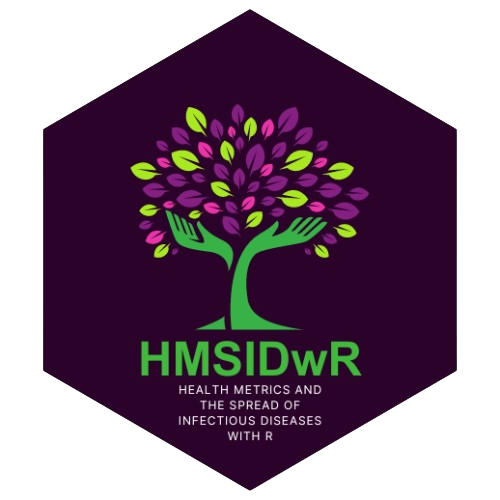

## Overview

::::: columns
::: {.column width="80%"}
This is the package that covers all datasets used in the **Health Metrics and the Spread of Infectious Diseases: Machine Learning Application and Spatial Modelling Analysis with R** book.

BOOK: <https://federicagazzelloni.com/hmsidR/>

GITHUB: <https://github.com/Fgazzelloni/hmsidwR>

VIGNETTE: <https://fgazzelloni.github.io/hmsidwR/>
:::

::: {.column width="20%"}
{fig-alt="hmsidwR R-package"}
:::
:::::

\
"It’s been an incredible journey, and while the book is nearing its completion, I feel a mix of emotions—both the excitement of sharing it with you and a touch of sadness that this creative process is coming to an end. 😌

Writing this book has been an immensely rewarding experience. I’ve spent countless hours into selecting the right material, striving to present it in a way that’s accessible and helpful for early-career researchers and students. One of the biggest challenges was deciding what to include and what to leave out, constantly refining the content to ensure it’s both comprehensive and easy to follow.

Even though the book is almost finished, my mind is still buzzing with ideas. There’s always that lingering thought of what else could be added to make it even better. But at some point, you have to step back and trust that what you’ve created will serve its purpose. And now, it’s time to see how it will resonate with you, the readers.

As I reflect on this journey, I’m filled with gratitude for all the support and feedback I’ve received along the way. *Your encouragement has been invaluable in shaping this book into what it is today.*

So, what’s next? While this project may be wrapping up, my passion for writing and sharing knowledge is far from over. Stay tuned for more updates and future projects! In the meantime, I invite you to dive into the book, explore its content, and share your thoughts. Your insights will be crucial as I make final touches and consider potential additions.

Thank you for being a part of this journey. I hope the book serves as a valuable resource for your research and studies. Let’s see where this new chapter takes us!

Happy learning! 🤓📚✨"
