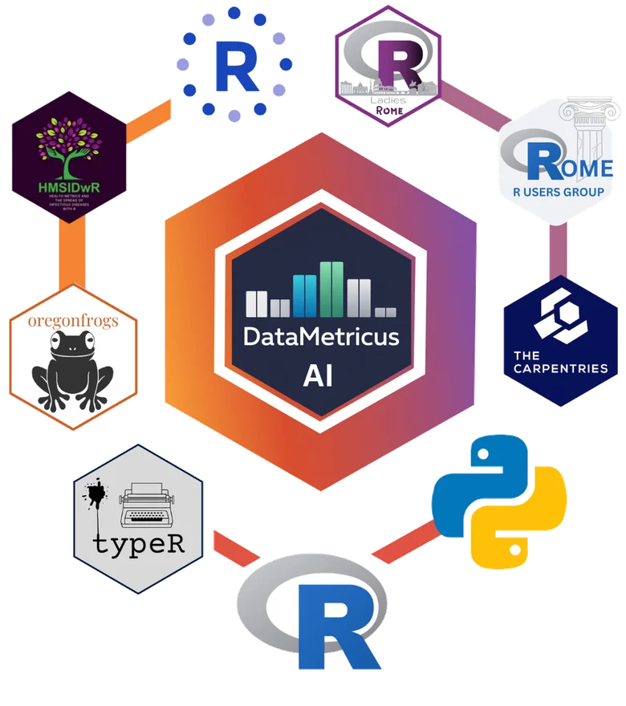
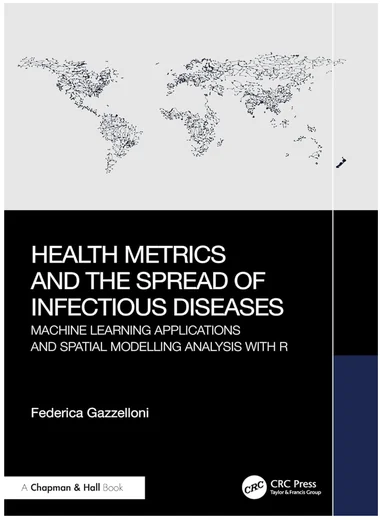

::: {.page-full}

```{=html}
<div class="scrolling-banner">
  <p class="multipleStrings">Welcome to my Website</p>
</div>

<script defer src="scripts/running-text.js"></script>

<section class="landing-hero" aria-labelledby="landing-title">
  <div class="landing-hero__content">
    <p class="landing-kicker">Actuarial science · health metrics · reproducible research</p>
    <h1 id="landing-title">AI-Augmented Analytics for Health, Risk, and Decision-Making</h1>
    <p class="landing-lede">
      I design analytical workflows that combine AI, statistics, R, and health metrics to turn complex data into practical decisions.
    </p>
    <div class="landing-actions" aria-label="Primary homepage actions">
      <a href="content/books/" class="landing-button landing-button--primary">Explore Books</a>
      <a href="content/apps/" class="landing-button">Try the Apps</a>
      <a href="about/workshops/" class="landing-button">Workshops &amp; Talks</a>
    </div>
    <p class="landing-consulting">
      <a href="consultancy.html">Consultancy <span aria-hidden="true">↗</span></a>
      <span>Consulting and training through DataMetricus.</span>
    </p>
  </div>

  <div class="landing-hero__visual" aria-label="Federica Gazzelloni analytics platform">
    
    <div class="landing-proof">
      <span>Author</span>
      <span>Health Metrics Research</span>
      <span>R Educator</span>
      <span>Actuary &amp; Statistician</span>
    </div>
  </div>
</section>

<section class="landing-pathways" aria-label="Explore tools, teaching, and research">
  <a href="about/workshops/" class="landing-pathway"><span>Tools &amp; Teaching</span><strong>Workshops, recordings, and materials to learn through practice.</strong></a>
  <a href="content/rpackages/" class="landing-pathway"><span>R Packages &amp; Apps</span><strong>Explore reusable tools and interactive analytical examples.</strong></a>
  <a href="content/blog/" class="landing-pathway"><span>Notes &amp; Research</span><strong>Follow the questions behind the code, models, and data.</strong></a>
</section>
```

:::

```{=html}
<section class="book-feature" aria-labelledby="featured-book-title">
  <a href="content/books/posts/hmsid/" aria-label="About Health Metrics and the Spread of Infectious Diseases">
    
  </a>
  <div>
    <p class="book-feature__eyebrow">Featured book · CRC Press · 2025</p>
    <h2 id="featured-book-title">Health Metrics and the Spread of Infectious Diseases</h2>
    <p>Learn to calculate health metrics, apply machine learning, and explore spatial patterns with practical R examples.</p>
    <div class="book-actions" aria-label="Featured book links">
      <a class="book-button book-button--primary" href="https://federicagazzelloni.com/hmsidR/">Read online — free</a>
      <a class="book-button" href="content/books/posts/hmsid/">About the book &amp; resources</a>
    </div>
    <p class="book-feature__note">Available in print from <a href="https://www.routledge.com/Health-Metrics-and-the-Spread-of-Infectious-Diseases-Machine-Learning-Applications-and--Spatial-Modelling-Analysis-with-R/Gazzelloni/p/book/9781032625782">Routledge</a>. Read about <a href="content/books/posts/hmsid/posts/062025/#publication-reflections">the writing journey</a>.</p>
  </div>
</section>
```

## Books in progress and further reading

::: {.portfolio-grid}
::: {.portfolio-card}
[Book in progress]{.status-badge}

### MASTA — Mortality Analytics

*Statistical Methods for Multi-Cause Attribution*, by Federica Gazzelloni and Sarah Cuschieri. How can we study mortality when several causes contribute to a death?

[Explore MASTA](content/books/posts/masta/index.qmd){.book-button}
:::
::: {.portfolio-card}
[Forthcoming · ACTEX]{.status-badge}

### CP2 — Actuarial Modelling

Forthcoming book and supporting materials through ACTEX. Access will require sign-up and purchase.

[CP2 access details](content/books/posts/cp2/index.qmd){.book-button}
:::
:::

[Explore all books and resources](content/books/index.qmd){.home-text-link}

## Tools, teaching, and consultancy

Explore my [data visualisation portfolio](content/blog/posts/dataviz/), [R packages](content/rpackages/), and [Shiny apps](content/apps/). Learn with [workshops and recorded materials](about/workshops/) or [statistics notes in R](content/blog/posts/stats/).

For statistical modelling, health metrics, reproducible research, and AI workflow automation, read about [DataMetricus consultancy](consultancy.qmd).

::: {.column-page}
::: {.home-lower}

```{=html}
<section class="home-latest" aria-labelledby="recent-work-title">
  <div class="home-section-heading">
    <div>
      <p class="home-eyebrow">Selected guides</p>
      <h2 id="recent-work-title">Notes, code, and practical guides</h2>
      <p>Explore selected notes and practical examples from my writing, research, and analytical workflows.</p>
    </div>
    <a class="home-text-link" href="content/blog/">Browse the notes <span aria-hidden="true">→</span></a>
  </div>
```

::: {#recent-work}
:::

```{=html}
</section>

<section class="home-newsletter" aria-labelledby="home-newsletter-title">
  <p class="home-eyebrow">My newsletter</p>
  <h2 id="home-newsletter-title">Notes on Data and Learning</h2>
  <p>Reflections on data, statistics, modelling, and what we learn through practice.</p>
  <div class="book-actions" aria-label="Newsletter links">
    <a class="book-button newsletter-button" href="https://federicagazzelloni.substack.com/subscribe">Subscribe on Substack <span aria-hidden="true">↗</span></a>
    <a class="home-text-link" href="content/newsletter/">Explore the newsletter <span aria-hidden="true">→</span></a>
  </div>
</section>

<section class="home-learning" aria-labelledby="home-learning-title">
  <div class="home-learning__content">
    <p class="home-eyebrow">Learn with me</p>
    <h2 id="home-learning-title">From an idea to a working example</h2>
    <p>Follow along with R tutorials, health metrics, and data science workflows. Watch a video or explore the recordings and materials from my workshops.</p>
    <div class="home-learning__links">
      <a class="book-button book-button--primary" href="https://www.youtube.com/@federicagazzelloni">Watch on YouTube <span aria-hidden="true">↗</span></a>
      <a class="home-text-link" href="about/workshops/">Explore workshops <span aria-hidden="true">→</span></a>
    </div>
  </div>
  <video class="home-learning__video" controls preload="none" playsinline aria-label="Welcome to Federica Gazzelloni’s data science channel" poster="images/homepage-logo.webp">
    <source src="images/welcome-video.mp4" type="video/mp4">
    <p><a href="https://www.youtube.com/@federicagazzelloni">Watch my videos on YouTube.</a></p>
  </video>
</section>

<link rel="stylesheet" href="scripts/news.css">
<section class="home-news" aria-labelledby="home-news-title">
  <div class="home-section-heading">
    <div>
      <p class="home-eyebrow">Beyond my own work</p>
      <h2 id="home-news-title">News I’m following</h2>
      <p>Recent headlines from the organisations behind the research, tools, and ideas.</p>
    </div>
  </div>
  <div id="news-topics" class="news-grid"></div>
  <p id="news-status" class="news-status" role="status">Loading recent headlines…</p>
  <noscript><p>Headlines reflect the last website update. Dates and publishers are shown for each article.</p></noscript>
</section>
<script src="scripts/news.js" defer></script>

```

:::
:::

<link rel="me" href="https://fosstodon.org/@fgazzelloni">
